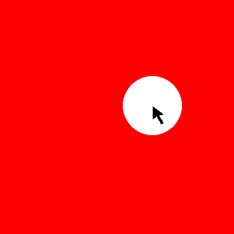
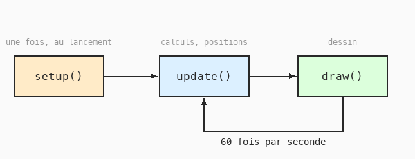
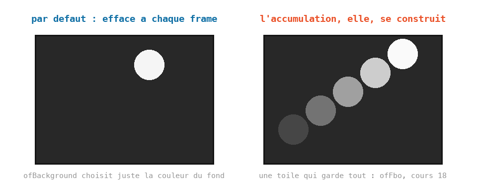

# Cours 05 — Le cycle setup / update / draw et la souris

> **Avant** : cours 04 (variables partagées dans le `.h`).
> **Comment travailler** : toujours dans `ofApp.h` et `ofApp.cpp`, par versions successives. `ofApp05.h` / `ofApp05.cpp` : la référence téléchargeable de l'état final.

Un cercle qui suit la souris. Le programme est minuscule — mais il met en place l'organisation qu'on gardera jusqu'à la fin de l'année : ce qui **change** va dans `update()`, ce qui **se dessine** va dans `draw()`.



## 1. Étape 1 — le programme entier

Il tient en quelques lignes. Dans `ofApp.h`, deux variables partagées :

```cpp
class ofApp : public ofBaseApp {
public:
	void setup();
	void update();
	void draw();

	float x { 0 };
	float y { 0 };
};
```

Dans `ofApp.cpp` :

```cpp
#include "ofApp.h"

void ofApp::setup() {
	ofSetWindowShape(400, 400);
}

void ofApp::update() {
	x = mouseX;
	y = mouseY;
}

void ofApp::draw() {
	ofBackground(255, 0, 0);
	ofSetColor(255);
	ofFill();
	ofDrawCircle(x, y, 50);
}
```

Un cercle blanc suit la souris sur fond rouge. Le cœur du cours est la répartition des rôles :



- `setup()` tourne **une fois**. Réglages.
- `update()` tourne **60 fois par seconde**. On y **calcule** : positions, vitesses, couleurs. Aucun ordre de dessin.
- `draw()` tourne juste après, 60 fois par seconde. On y **dessine**, à partir des variables calculées. On n'y modifie rien.

Rien ne t'empêche de tout mettre dans `draw()` — ça marcherait. Mais séparer rend le code lisible : quand un dessin est faux, tu sais si l'erreur est dans le **calcul** ou dans l'**affichage**. Toute la suite du cours respecte cette règle.

> **Essaie** : un décalage — `x = mouseX + 100;`. Le cercle suit la souris, cent pixels plus à droite.

## 2. Étape 2 — des variables qui traversent les frames

Regarde le trajet de `x` : **écrite** dans `update()`, **lue** dans `draw()`. Deux blocs différents — elle doit donc être partagée, déclarée dans le `.h` comme les listes du cours 04. Et elle est **persistante** : sa valeur reste d'une frame à la suivante. Ici on l'écrase à chaque frame, mais dès le cours 06, cette persistance permettra d'avancer *petit à petit* — c'est elle qui rend le mouvement possible.

`mouseX` et `mouseY` sont deux variables partagées fournies par openFrameworks, mises à jour toutes seules avant chaque `update()`.

> **Essaie** : le cercle ne suit que l'horizontale (`y` fixé à 200). Puis ajoute une variable partagée `float rayon` calculée dans `update()` : `rayon = mouseX / 4.0f;` — le cercle grossit vers la droite.

## 3. Étape 3 — le fond : qui efface, et où

Fais l'expérience : **enlève** la ligne `ofBackground(255, 0, 0);` et bouge la souris. Surprise : pas de traînée — le fond redevient gris et le cercle reste net. C'est qu'openFrameworks **efface la fenêtre à chaque frame**, tout seul, avec la dernière couleur de fond connue (gris par défaut).

À quoi sert la ligne, alors ? À **choisir** la couleur d'effacement, et à rendre l'ordre du dessin explicite : le fond d'abord, les formes ensuite. C'est la convention openFrameworks — au cours 01 on posait la couleur une fois dans `setup()`, désormais on l'écrit en tête de `draw()`.



Et si on **veut** une traînée — des formes qui s'accumulent ? Ça ne s'obtient pas en supprimant une ligne : c'est un effet qui se **construit**, avec une toile qui garde ce qu'on y dessine (`ofFbo`, cours 18 — c'est ainsi que le projet final peindra).

> **Essaie** : remets `ofBackground`, mais à la **fin** de `draw()`. Tout disparaît — pourquoi ? (L'ordre des lignes DANS `draw()` compte : on a peint le fond par-dessus le cercle.)

## 4. Relire le cours 00 avec les bons mots

Tu peux maintenant relire `ofApp00a.cpp` et tout nommer :

- `funnyFace` est une fonction à nous, annoncée dans le `.h`, avec deux paramètres.
- `draw()` efface avec `ofBackground(30)` puis dessine la tête à `(mouseX, mouseY)`.
- `update()` y était resté **vide** — tu sais maintenant à quoi il sert : c'est là que les nombres changent, et dès le cours 06 il fera bouger les choses tout seul.

## Exercices

1. **Lire avant de lancer** — décris ce que fait ce programme avant de le taper :

   ```cpp
   void ofApp::update() {
   	x = mouseX;
   	y = 300;
   }

   void ofApp::draw() {
   	ofBackground(30);
   	ofDrawCircle(x, y, mouseY / 4.0f);
   }
   ```

   Sur quelle trajectoire le cercle se déplace-t-il ? Qu'est-ce qui le fait grossir ?

2. **L'opposé** — le cercle va à l'inverse de la souris : souris à droite, cercle à gauche (et pareil verticalement). Indice : `ofGetWidth()` et `ofGetHeight()` donnent la taille de la fenêtre.

3. **Le kaléidoscope** — quatre cercles à la fois : la souris, son symétrique horizontal, son symétrique vertical, et le symétrique des deux. Bouge la souris : les quatre dansent ensemble.

## Ce qu'il faut retenir

- Le cycle : `setup()` une fois, puis `update()` (calculer) et `draw()` (dessiner), 60 fois par seconde.
- La règle d'organisation : les calculs dans `update()`, le dessin dans `draw()` — pour savoir où chercher les erreurs.
- Une variable du `.h` est partagée entre les blocs **et** persistante d'une frame à l'autre.
- `mouseX`, `mouseY` : la position de la souris, mise à jour toute seule.
- openFrameworks efface la fenêtre à chaque frame ; `ofBackground` en tête de `draw()` **choisit** la couleur du fond — et l'ordre dans `draw()` compte. L'accumulation volontaire attendra l'`ofFbo` (cours 18).
