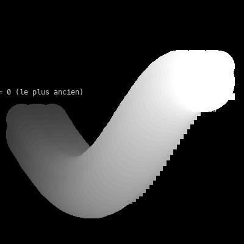
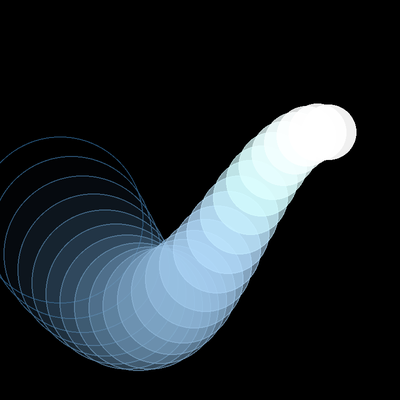

# Cours 07 — Traînée : mémoriser les positions, faire varier chaque élément

> **Avant** : cours 04 (`std::vector`), cours 05 (update / draw), cours 06 (le temps).
> **Comment travailler** : toujours dans `ofApp.h` et `ofApp.cpp`, par versions successives. `ofApp07.h` / `ofApp07.cpp` (l'état après la première partie) et `ofApp07a.h` / `ofApp07a.cpp` (l'état final, la traînée évoluée) sont la référence téléchargeable.

Un ours suit la souris, et les cinquante positions précédentes restent affichées derrière lui. Deux outils nouveaux : écrire **nos propres fonctions**, et utiliser une liste comme **mémoire** des dernières frames. Puis, en deuxième partie, chaque élément de la traînée prendra sa propre taille, sa propre transparence et sa propre couleur.


## 1. Étape 1 — `bear()` : ta propre fonction

Depuis le cours 00 on utilise des fonctions fournies, comme `ofDrawCircle` — et on a lu `funnyFace`, une fonction fabriquée. Cette fois, tu écris la tienne. Un ours, c'est six cercles et un rectangle ; plutôt que de recopier ces sept lignes à chaque fois, on les range dans une **fonction** :

```cpp
// Un ours dessiné autour du point (x, y)
void ofApp::bear(float x, float y) {
	ofDrawCircle(x - 25, y - 25, 25);
	ofDrawCircle(x + 25, y - 25, 25);
	ofDrawCircle(x, y, 50);
	ofDrawCircle(x, y, 10);
	ofDrawCircle(x - 30, y - 20, 10);
	ofDrawCircle(x + 30, y - 20, 10);
	ofDrawRectangle(x, y + 20, 50, 10);
}

void ofApp::draw() {
	ofBackground(0);
	ofSetColor(255);
	ofFill();
	bear(mouseX, mouseY);
}
```

Et dans le `.h`, **annonce** la fonction — une ligne, sans le corps, sinon le compilateur ne connaît pas `bear` quand il lit `draw()` :

```cpp
	void bear(float x, float y);
```

Un ours suit la souris. Anatomie de la définition :

| Morceau | Rôle |
|---|---|
| `void` | la fonction ne renvoie rien, elle fait juste quelque chose |
| `ofApp::bear` | son nom (le `ofApp::` devant est obligatoire dans ce projet, comme pour `setup` et `draw`) |
| `float x, float y` | ses **paramètres** : deux nombres que celui qui appelle doit fournir |
| `{ ... }` | son corps : ce qu'elle fait |

Toutes les positions à l'intérieur sont écrites **par rapport à `(x, y)`** : `x - 25`, `y + 20`. C'est ce qui rend l'ours déplaçable — `bear(100, 100)` en dessine un autour de (100, 100). Exactement ce que faisait `funnyFace` au cours 00.

> **Essaie** : écris ta propre fonction `void etoile(float x, float y)` (ou n'importe quelle figure) et remplace l'ours.

## 2. Étape 2 — les paramètres sont des copies

Quand on appelle `bear(mouseX, mouseY)`, la fonction ne reçoit pas les variables de l'appelant : elle reçoit des **copies**. Ses cases `x` et `y` (cours 01) naissent à l'appel, reçoivent les valeurs copiées, et meurent à l'accolade fermante :

```
  chez l'appelant             dans bear
  +----------+    copie     +----------+
  |  mouseX  |  -------->   |    x     |     nait a l'appel,
  |   412    |              |   412    |     meurt a la fin
  +----------+              +----------+
```

Conséquence : modifier `x` à l'intérieur de `bear` ne change **pas** `mouseX` — une fonction ne peut pas abîmer les variables de son appelant, et chaque appel repart de cases neuves. C'est le **passage par valeur**. Quand une fonction devra *fabriquer* une valeur pour son appelant, elle la **renverra** avec `return` : tu le verras au cours 11 avec `filtre()`.

> **Essaie** : ajoute `x = 0;` en première ligne de `bear` — l'ours se fige à gauche, mais la souris (et `mouseX`) continue de vivre sa vie. La copie protège l'appelant.

## 3. Étape 3 — une liste comme mémoire : la file

Dans le `.h`, la position et deux listes partagées :

```cpp
	float x { 0 };
	float y { 0 };
	std::vector<float> xCoords;
	std::vector<float> yCoords;
```

Dans `update()` :

```cpp
void ofApp::update() {
	xCoords.push_back(x);                    // 1. mémoriser la position courante
	yCoords.push_back(y);

	if (xCoords.size() >= 50) {              // 2. borner la mémoire :
		xCoords.erase(xCoords.begin());      //    retirer la plus ancienne
		yCoords.erase(yCoords.begin());
	}

	x = mouseX;                              // 3. mettre à jour
	y = mouseY;
}
```

À l'écran, rien de neuf — la mémoire se remplit en coulisses. Affiche `xCoords.size()` dans la console (cours 04) : elle monte jusqu'à 50 et s'y stabilise.

À chaque frame : on **ajoute** la position courante à la fin, si la liste dépasse 50 on **retire le premier** élément (`erase(begin())` : « supprime l'élément d'indice 0 », les autres se décalent), puis on met à jour la position. L'ordre compte : mémoriser **avant** de mettre à jour, sinon la position courante serait en double.

Une liste où l'on ajoute à la fin et retire au début s'appelle une **file**. Bornée à 50, elle contient toujours les 50 dernières positions — ni plus, ni moins.

Dernier point : deux listes **parallèles**. `xCoords[i]` et `yCoords[i]` forment ensemble la position numéro `i` — il faut toujours les modifier ensemble.

> **Essaie** : change 50 en 10, puis en 200 (tu verras l'effet à l'étape 4). Puis, *plus fin* : ne mémorise qu'une frame sur deux — indice : une variable partagée `int compteur` et `%` (le reste de la division : `compteur % 2` vaut 0 une frame sur deux).

## 4. Étape 4 — dessiner toute la mémoire



Dans `draw()` :

```cpp
	for (int i = 0; i < xCoords.size(); i++) {
		bear(xCoords[i], yCoords[i]);
	}
	bear(x, y);
```

La boucle du cours 04 : un ours par position mémorisée. L'indice 0 est le plus **ancien**, `size() - 1` le plus récent. Puis l'ours courant, par-dessus.

Cinquante ours blancs identiques se fondent en une masse — c'est **exprès** : la deuxième partie de ce cours fera varier couleur, transparence et taille selon `i`, et la profondeur apparaîtra.

> **Essaie** : `ofSetColor(i * 5);` dans la boucle — un gris qui s'éclaircit vers les positions récentes. Premier aperçu de la deuxième partie.

## Pour aller plus loin : une `struct`

Deux listes parallèles fonctionnent, mais c'est fragile : rien n'empêche d'oublier un `push_back` sur l'une des deux. C++ permet de **regrouper** plusieurs variables sous un seul nom avec une `struct` :

```cpp
struct Position {
	float x;
	float y;
};
```

Une `struct` est un type fabriqué par toi, et on accède à ses morceaux avec un point : `p.x`, `p.y` — la même syntaxe que `noms.size()` au cours 04.

### La `struct` en mémoire

En mémoire, les membres d'une `struct` vivent dans des **cases collées** (cours 01) : une `Position` occupe une case double, 2 × 4 octets. Et un `std::vector<Position>` aligne ces paires **bout à bout** — un seul ruban `x y x y x y…`, là où les deux listes parallèles faisaient deux rubans à garder synchronisés :

```
  Position p :          +-----+-----+
                        |  x  |  y  |       deux float colles : une case double
                        +-----+-----+

  vector<Position> :    +-----+-----++-----+-----++-----+-----+
                        |  x  |  y  ||  x  |  y  ||  x  |  y  | ...
                        +-----+-----++-----+-----++-----+-----+
                            [0]          [1]          [2]
```

`positions[i]` est la paire numéro `i` ; `positions[i].x` en ouvre le premier compartiment.

### La file, réécrite avec la `struct`

```cpp
// ofApp07.h :  struct Position { float x; float y; };
//              std::vector<Position> positions;     // UNE liste remplace les deux

void ofApp::update() {
	Position p;                              // une case double...
	p.x = x;  p.y = y;
	positions.push_back(p);                  // ...mémorisée d'un seul geste

	if (positions.size() >= 50) {
		positions.erase(positions.begin());  // un seul erase aussi
	}
	x = mouseX;  y = mouseY;
}

void ofApp::draw() {
	ofBackground(0);
	ofFill();
	ofSetColor(255);
	for (int i = 0; i < positions.size(); i++) {
		bear(positions[i].x, positions[i].y);
	}
	bear(x, y);
}
```

Un seul `push_back`, un seul `erase` : la file ne peut plus se désynchroniser. À l'écran, rien ne change — on a réécrit pour *nous*, plus sûr et plus lisible. Ce geste a un nom, **remanier** (*refactoring*), et tu le referas toute ta vie.

openFrameworks fournit `glm::vec2`, qui est exactement cette struct avec des opérations en plus : on pourrait remplacer `Position` par `glm::vec2` sans rien changer d'autre. Tu verras au cours 10 que les couleurs fonctionnent pareil : `c.r`, `c.g`, `c.b`.

## Exercices

1. **Lire avant de lancer** — la file est bornée à 5, et `draw()` contient :

   ```cpp
   for (int i = 0; i < xCoords.size(); i++) {
   	ofDrawCircle(xCoords[i], yCoords[i], 5 + i * 5);
   }
   ```

   Le plus gros cercle est-il sous la souris, ou en queue de traînée ? Réponds, puis vérifie.

2. **Le serpent réglable** — la longueur de la file dépend de la souris : on retire des éléments tant que `size()` dépasse `mouseX / 10`. Souris à gauche : serpent court ; à droite : long. Attention, il faudra peut-être retirer **plusieurs** éléments dans la même frame.

3. **Les deux traînées** — une deuxième file qui mémorise le point **opposé** à la souris (cours 05, exercice 2). Deux traînées miroir qui dansent ensemble.

4. **La constellation filante** *(plus costaud)* — combine 03, 04 et 07 : cinquante étoiles fixes (listes remplies dans `setup()`), plus une traînée qui suit la souris. Deux mémoires de natures différentes dans le même programme : l'une remplie une fois, l'autre entretenue à chaque frame.

## Autonomie

À partir de la traînée de ce cours, fabrique une **traînée évoluée** : chaque élément de la file doit avoir son propre aspect, qui dépend de sa place dans la file et du moment. La deuxième partie de ce document est le corrigé : ne la lis qu'une fois ta version terminée.

Ce que tu as en main :

- **l'indice `i`** de la boucle de dessin, de 0 (le plus ancien) à la taille de la file moins 1 (le plus récent). Tout ce qui doit changer le long de la traînée se calcule à partir de lui ;
- **le temps** `ofGetElapsedTimef()`, en secondes, pour ce qui doit changer au fil du temps. Avec `cos`, il oscille (cours 06, exercice 5) ;
- **une fonction de dessin** à toi, comme `bear`, à laquelle tu ajoutes des paramètres : au minimum la position, l'indice et le temps.

Les paramètres sur lesquels jouer, à combiner comme tu veux :

| Paramètre | Idées |
|---|---|
| longueur de la file | 10, 25, 100 : la traînée est courte et nerveuse ou longue et fluide |
| taille selon `i` | plus petite à l'arrière et plus grosse à l'avant, ou l'inverse, ou qui ondule le long de la traînée |
| taille selon le temps | qui pulse ; plus fort à l'arrière qu'à l'avant |
| transparence selon `i` | le quatrième nombre de `ofSetColor` : de transparent à opaque le long de la traînée |
| remplissage et contour | deux passes (cours 02), avec des transparences opposées : l'un s'efface quand l'autre apparaît |
| couleur de base | animée par le temps, comme le fond du cours 06 (exercice 5) |
| couleur selon `i` | éclaircie ou assombrie vers l'avant, un canal qui monte le long de la traînée |
| forme | cercle, carré, l'ours, ou une alternance selon la parité de `i` |

Les contraintes :

- la logique reste dans `update()`, le dessin dans `draw()`, la forme dans une fonction ;
- tes nombres doivent rester dans leurs bornes : une taille ne devient pas négative, une composante de couleur reste entre 0 et 255. Avant d'écrire une formule, note la valeur qu'elle donne pour `i = 0` et pour le dernier `i` ;
- change **une seule chose à la fois**, lance, regarde, puis passe à la suivante.

## La traînée évoluée — le corrigé de l'Autonomie

Cette deuxième partie est le **corrigé de l'Autonomie** ci-dessus. C'est une solution possible, pas la seule : si la tienne fait autre chose et que les contraintes sont respectées, elle est aussi valable.

La traînée de la première partie, mais chaque élément a sa propre taille, sa propre transparence et sa propre couleur, calculées à partir de son **indice** dans la file et du **temps**. Rien de nouveau dans les outils : c'est une partie sur ce qu'on peut faire en **combinant** ceux qu'on a. L'état final est la référence `ofApp07a`.



## 5. Étape 5 — le temps : une couleur qui vit

Repars de la traînée de la première partie, en remplaçant l'ours par un simple cercle, avec une file de 25 — la référence `ofApp07a` renomme les listes `prevX`, `prevY` — plus, dans le `.h`, `float t { 0 };` et `float r { 0 }, g { 0 }, b { 0 };`. Dans `update()` :

```cpp
	t = ofGetElapsedTimef();
	r = (cos(t * 1.2f) / 2 + 0.5f) * 255;
	g = (cos(t * 1.0f) / 2 + 0.5f) * 255;
	b = (cos(t * 0.86f) / 2 + 0.5f) * 255;
```

Et dans `draw()`, `ofSetColor(r, g, b)` avant les cercles : toute la traînée change de couleur en continu.

`ofGetElapsedTimef()` : le temps écoulé depuis le lancement, en secondes. C'est l'**autre** façon d'animer, à côté de la vitesse du cours 06 : au lieu d'ajouter un pas à chaque frame, on **calcule directement** une valeur à partir du temps.

La formule, enfin expliquée : `cos(t)` oscille entre −1 et 1 quand `t` avance ; `/ 2 + 0.5f` le ramène entre 0 et 1 ; `* 255` entre 0 et 255. Le nombre qui multiplie `t` est la **vitesse d'oscillation** — trois vitesses différentes pour `r`, `g`, `b`, et la couleur se promène sans jamais se répéter.

> **Essaie** : change les trois vitesses (`1.2f`, `1.0f`, `0.86f`). Avec trois vitesses **égales**, que devient le fond de couleurs ? (Réponse attendue : un simple gris qui pulse — pourquoi ?)

## 6. Étape 6 — un nombre qui dépend de l'indice

La variable-clé de cette partie, dans la boucle de dessin :

```cpp
	for (int i = 0; i < prevX.size(); i++) {
		float offset = i * 10;

		ofFill();
		ofSetColor(r + offset, g + offset, b + offset, offset);
		ofDrawCircle(prevX[i], prevY[i], 40);

		ofNoFill();
		ofSetColor(r + offset, g + offset, b + offset, 255 - offset);
		ofDrawCircle(prevX[i], prevY[i], 40);
	}
```

`i` va de 0 à 24, donc `offset` va de 0 à 240. Tout ce qui doit changer **le long** de la traînée se calcule à partir de lui :

- le remplissage a pour transparence `offset` : le plus ancien (`i = 0`) est invisible, le plus récent presque opaque ;
- le contour a pour transparence `255 - offset` : l'**inverse** — les anciens n'ont qu'un contour, les récents un plein ;
- la couleur est éclaircie de `offset` : les récents tirent vers le blanc.

Deux passes fill / contour (cours 02) avec des transparences **croisées** : c'est ça qui donne la profondeur.

Une remarque pour plus tard : `r + offset` peut dépasser 255. Ici le sketch compte sur openFrameworks pour arrondir, mais ce n'est pas garanti — au cours 10 on apprendra à **borner** proprement avec `ofClamp`.

> **Essaie** : `offset / 2` à la place d'`offset` dans la transparence. Puis remplace `(255 - offset)` par `offset` : que devient l'effet de profondeur ?

## 7. Étape 7 — ranger la recette dans une fonction

La boucle devient illisible ? Range l'aspect d'un élément dans une fonction — c'est le geste de l'étape 1, avec plus de paramètres :

```cpp
// i : indice dans la traînée (0 = le plus ancien). t : temps en secondes.
void ofApp::forme(float x, float y, int i, float t, float r, float g, float b) {
	float offset = i * 10;

	ofFill();
	ofSetColor(r + offset, g + offset, b + offset, offset);
	ofDrawCircle(x, y, 40);

	ofNoFill();
	ofSetColor(r + offset, g + offset, b + offset, 255 - offset);
	ofDrawCircle(x, y, 40);
}

void ofApp::draw() {
	ofBackground(0);
	for (int i = 0; i < prevX.size(); i++) {
		forme(prevX[i], prevY[i], i, t, r, g, b);
	}
}
```

(Et l'annonce dans le `.h`, comme toujours.) Sept paramètres : la fonction reçoit **tout ce dont elle a besoin** — position, indice, temps, couleur de base — et n'invente rien. Le point important : elle ne décide pas de son aspect toute seule, elle le **déduit** de `i` et de `t`. Le même code dessine 25 cercles tous différents.

> **Essaie** : remplace le cercle par l'ours de la première partie, en lui ajoutant un paramètre de taille pour que tout soit proportionnel.

## 8. Étape 8 — combiner indice et temps

La taille, dernière pièce — dans `forme()` :

```cpp
	float taille = (cos(i / 5.0f) + 5) * 20;
	float variation = (cos(t * 1.2f) + 5) * 100;
	float tailleFinale = taille + variation * (25 - i) / 50.0f;
	ofDrawCircle(x, y, tailleFinale / 2);
```

- `taille` dépend de `i` : elle ondule **le long** de la traînée ;
- `variation` dépend de `t` : elle pulse **dans le temps** ;
- `(25 - i) / 50.0f` vaut 0.5 pour le plus ancien et presque 0 pour le plus récent : la pulsation est plus forte à l'arrière.

Trois lignes, et chaque cercle a une taille qui dépend à la fois de sa place et du moment. Il n'y a pas de recette magique : on assemble des morceaux qui varient entre des **bornes connues**, et on regarde. (Les `5.0f` et `50.0f` évitent la division entière — cours 01.)

> **Essaie** : invente **ta** formule de taille. Avant de la taper, note sa valeur pour `i = 0` et `i = 24` — la discipline de l'Autonomie.

## Ce que ce cours prépare

On a fabriqué une couleur avec trois cosinus. Ça marche, mais on ne contrôle rien : on ne sait pas quelle teinte vient ensuite, et la couleur passe par des gris. Le cours 09 donne un outil bien plus direct : décrire une couleur par sa **teinte**.

## Exercices

1. **Lire avant de lancer** — si on remplace `float offset = i * 10;` par `float offset = (25 - i) * 10;`, dans quel sens la traînée s'estompe-t-elle ? Réponds, puis vérifie.

2. **Pair, impair** — un cercle pour `i` pair, un carré pour `i` impair : `if (i % 2 == 0)`. Le `%` donne le reste de la division — il vaut 0 une fois sur deux.

3. **Le feu follet** — la pulsation temporelle appliquée à la **transparence du contour** au lieu de la taille : une traînée qui bat comme un cœur, sans changer de forme.

4. **La traînée miroir** *(plus costaud)* — dessine la file une deuxième fois, symétrique (`800 - x`), avec une formule d'aspect **différente** (autre taille, autres transparences). Deux créatures liées par la même mémoire.

## Ce qu'il faut retenir

- Définir une fonction : `void ofApp::nom(float a, float b) { ... }` — et **l'annoncer** dans le `.h`.
- Les paramètres sont des **copies** : la fonction ne peut pas abîmer les variables de l'appelant (passage par valeur).
- Une **file** : `push_back` à la fin + `erase(begin())` au début, bornée par un `if` sur `size()`.
- Mémoriser avant de mettre à jour — l'ordre des instructions dans `update()` compte.
- Deux listes parallèles = une donnée par indice ; à modifier toujours ensemble (la `struct` les fusionne).
- `ofGetElapsedTimef()` : le temps en secondes — animer en **calculant depuis le temps**, l'alternative à la vitesse du 06.
- `cos(t * vitesse) / 2 + 0.5f` : une oscillation douce entre 0 et 1, à la vitesse choisie.
- Tout ce qui varie le long d'une file se calcule depuis l'**indice** `i` ; tout ce qui varie au fil du temps, depuis `t` — et on peut combiner les deux.
- Une fonction de dessin reçoit **tout** en paramètres et déduit son aspect : le même code, vingt-cinq résultats différents.
- Assembler des formules = connaître leurs **bornes** avant de les taper.
